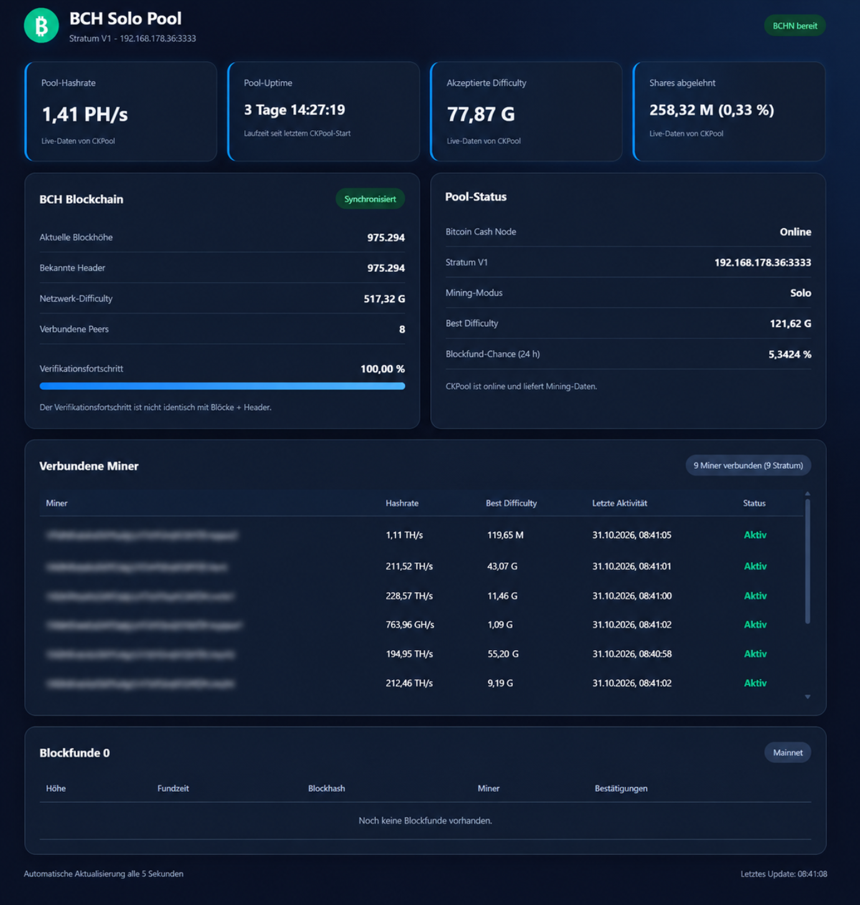

# Bitcoin Cash Mainnet Solo Mining Pool – Installer v1

Automatisierte **Installation** für eine neue Debian-13-(Trixie)-VM auf x86_64. Enthält BCHN 29.2.0, den angepassten CKPool, das originale Flask-Dashboard, systemd-Dienste und Diagnose-Skripte.

**Status:** Der automatische Installationsablauf wurde auf einer frischen Debian-13-VM mit vorhandenem Blockchain-Backup erfolgreich bis zum erreichbaren Dashboard getestet. Für eine Neuinstallation vorgesehen; nicht auf einem bereits eingerichteten Pool ausführen.

## Dashboard-Vorschau



## Voraussetzungen

- Debian 13 (eine Desktop-Oberfläche ist nicht erforderlich), mit aktiviertem SSH-Zugang und einem normalen Benutzer mit eingerichteten `sudo`-Rechten (bei Minimalinstallation ggf. erst einrichten)
- IPv4-Adresse im vertrauenswürdigen LAN; der Installer ermittelt sie über die Standardroute automatisch. Für dauerhafte Erreichbarkeit eine DHCP-Reservierung im Router einrichten **oder eine feste IPv4-Adresse direkt in Debian konfigurieren**
- Eigene **Bitcoin-Cash-Mainnet-Legacy-P2PKH-Adresse** (beginnt mit `1`); **niemals Seed oder privaten Schlüssel eingeben**
- Mindestens ca. 4 GB RAM empfohlen, ausreichend Speicherplatz und Internetverbindung; der BCHN-Download benötigt Zeit
- Noch **kein** BCHN, CKPool oder Dashboard auf dieser VM

## Kurzanleitung

Nach der Debian-Installation auf der **neuen VM** anmelden. **Falls `sudo` noch nicht installiert ist**, zunächst als `root` anmelden (z. B. mit `su -`) und `sudo` installieren sowie dem eigenen Benutzer die Berechtigung geben:

```bash
su -
apt-get update
apt-get install -y sudo
usermod -aG sudo DEIN_BENUTZERNAME
exit
```

**Wichtig vor dem Installer-Start:** Falls bereits ein Backup der BCH-Blockchain vorhanden ist, dieses vorher auf die VM kopieren – am besten in das Verzeichnis `/var/backups/bchn/` (z. B. `/var/backups/bchn/bchn-blockchain.tar.gz`). Der Installer fragt später nach dem Pfad. Ohne Backup ist dieser Schritt nicht erforderlich.

Danach **neu anmelden** (damit die Gruppenzugehörigkeit aktiv wird) und mit dem normalen Benutzer fortfahren:

```bash
sudo apt-get update
sudo apt-get install -y git python3 openssl iproute2
git clone --branch installer-v1 https://github.com/matlen67/debian-bitcoincache-mining-pool.git
cd debian-bitcoincache-mining-pool
bash setup-pool.sh
```

Der Installer fragt nach einer BCH-Legacy-Adresse als Konfigurations- und Dashboard-Referenz; die LAN-IP wird automatisch ermittelt und zur Bestätigung angezeigt. **Im CKPool-Solo-Modus (`-B`) bestimmt die gültige BCH-Adresse im Stratum-Benutzernamen jedes Miners dessen eigene Coinbase-Auszahlung.** Die Konfigurationsadresse ist keine feste Auszahlung für alle Miner.

## Optionales Blockchain-Backup

Falls bereits ein Blockchain-Backup (`bchn-blockchain.tar.gz`) vorhanden ist, dieses **vor dem Installer-Start selbstständig auf die VM übertragen**, beispielsweise nach `/var/backups/bchn/bchn-blockchain.tar.gz`. Die Übertragung und Bereitstellung des Backups sind nicht Bestandteil des Installers. **Nicht `/tmp` verwenden**, wenn es als kleines RAM-Dateisystem (`tmpfs`) eingebunden ist.

Der Installer fragt zuerst, ob ein Backup vorhanden ist. Bei **Ja** den vollständigen lokalen Dateipfad angeben oder den angezeigten Beispielpfad mit Enter übernehmen. Das Archiv wird geprüft; fehlt es oder ist es ungültig, bricht die Installation ab. Danach wird BCHN automatisch installiert, `blocks` und `chainstate` werden wiederhergestellt und die Node gestartet. Die neue `bitcoin.conf` bleibt erhalten.

Bei **Nein** installiert der Installer BCHN ohne Rücksicherung und startet die vollständige Blockchain-Synchronisierung. **Währenddessen zeigt er regelmäßig den Fortschritt an und wartet bis zum Abschluss.** Je nach Internetverbindung und Hardware kann das mehrere Stunden dauern. Anschließend installiert und startet er CKPool und Dashboard automatisch.

Der Installer prüft die Installation und aktiviert anschließend beide Dienste automatisch. Status prüfen:

```bash
sudo systemctl is-active bchn.service bch-ckpool.service bch-dashboard.service
```

Danach im LAN das Dashboard öffnen: `http://DEINE-SERVER-IP:8080/`. Miner verwenden die Server-IP mit Stratum-Port `3333` und als Benutzernamen `DEINE_BCH_LEGACY_ADRESSE.workername` (Passwort z. B. `x`). Bei einem Walletwechsel nur die Adresse im Miner ändern; CKPool muss dafür nicht neu konfiguriert werden. **Wichtig:** Die fest konfigurierte `PAYOUT_SCRIPT`-Referenz im Dashboard ist nicht automatisch eine vollständige Abbildung aller individuellen Miner-Auszahlungen. Dashboard-Anzeigen zur Auszahlung daher nicht ohne gesonderte Prüfung als verbindlich ansehen.

## Diagnose und Erkenntnisse aus dem Frischinstallations-Test

- Die Dashboard-Adresse lautet `http://SERVER-IP:8080/`.
- `error code: -28` / `Verifying wallet...` unmittelbar nach dem ersten BCHN-Start kann eine vorübergehende Startphase sein. Der Installer wartet und zeigt regelmäßig den Status.
- `Cannot assign requested address` beim Flask-Start deutet auf eine nicht mehr vorhandene Bind-IP in `/etc/systemd/system/bch-dashboard.service` hin. Der Installer bindet bei Neuinstallationen jetzt an `DASHBOARD_HOST=0.0.0.0`, damit DHCP-Wechsel nicht zum Startfehler führen. **Nur im vertrauenswürdigen LAN einsetzen; kein Portforwarding.** `STRATUM_HOST` zeigt weiterhin die beim Setup erkannte IP an und muss nach einem IP-Wechsel gegebenenfalls aktualisiert werden.
- Die gespeicherte `SERVER_IP` in `~/.config/bch-solo-installer/setup.env` wird durch `git pull` **nicht rückwirkend geändert**. Bestehende systemd-Dateien werden ebenfalls nicht automatisch überschrieben.
- Ein `systemctl is-active` unmittelbar nach dem Start allein beweist noch nicht, dass Flask erreichbar ist. `setup-pool.sh` prüft nun zusätzlich einen stabilen Dashboard-Dienst und TCP-Port 8080.
- Die ältere [manuelle Referenzanleitung](docs/INSTALLATIONSANLEITUNG-v2.md) ist aus Integritätsgründen unverändert und beschreibt teils eine frühere Benutzerstruktur.

## Diagnose

```bash
sudo systemctl status bchn.service bch-ckpool.service bch-dashboard.service --no-pager
sudo journalctl -u bch-ckpool.service -n 80 --no-pager
sudo journalctl -u bch-dashboard.service -n 80 --no-pager
sudo ss -ltnp | grep -E ':(3333|8080) '
```

Bei Fehlern **nicht auf der produktiven VM nachstellen**. Die historische manuelle Referenz ist in [docs/INSTALLATIONSANLEITUNG-v2.md](docs/INSTALLATIONSANLEITUNG-v2.md); für die aktuelle automatische Installation gilt die Kurzanleitung oben. Einzelne Stufen: `bash run-stages.sh --help`.

## Originaldateien und Integrität

Alle acht Dateien aus dem getesteten Referenzpaket sind im Branch vorhanden: sechs Dashboard-Dateien, der [BCH-CKPool-Patch](patches/bch-ckpool-mainnet.patch) und die Installationsanleitung. Der Installer prüft ihre SHA256-Werte vor Beginn. **Es ist kein zusätzliches ZIP und kein manueller Import mehr erforderlich.**

Der Patch wird nur nach erfolgreichem `git apply --check` angewendet. Wenn der gepinnte CKPool-Commit nicht erreichbar ist oder der Patch nicht passt, stoppt die Installation.

## Sicherheit und bekannte Einschränkungen

- Der BCHN-Download wird mit der SHA256-Prüfsumme der Referenzinstallation verglichen. Eine unabhängige Herausgebersignatur wurde noch nicht überprüft.
- Das Dashboard verwendet den Flask-Entwicklungsserver **ohne Login**. Port 8080 niemals ins öffentliche Internet freigeben.
- **Getestet auf Debian 13 mit bereits synchronisierter BCHN:** Wiederholungsinstallation (`--reuse-bchn`), CKPool-/Dashboard-Dienststart und echte akzeptierte Bitaxe-Shares (0 Rejected im beobachteten Log). Zwei unterschiedliche BCH-Legacy-Adressen wurden als Stratum-Benutzernamen autorisiert; die jeweiligen P2PKH-Auszahlungsskripte wurden in den zusammengesetzten Coinbase-Daten eines empfangenen Mining-Jobs gefunden. Beide Adressen können zur selben Wallet gehören.
- **Noch nicht verifiziert:** Vollständige Synchronisierung ab Genesis ohne Backup, unabhängige vollständige Dekodierung aller Coinbase-Ausgänge, tatsächlich gefundener/eingereichter Block und reale Blockauszahlung. Die bisherigen Coinbase-Tests prüfen das Vorkommen des erwarteten Skripts, nicht den erfolgreichen Mainnet-Blockfund.
- RPC-Zugangsdaten und `bitcoin.conf`/`bchsolo.conf` nicht committen; Wallet-Seeds und private Schlüssel werden nicht benötigt.
- Bei Installationsfehlern kann eine teilweise Einrichtung verbleiben. Vor der Installation nach Möglichkeit einen VM-Snapshot erstellen.

## GitHub-Prüfung

[Installer static checks](.github/workflows/installer-checks.yml) prüft Bash-/Python-/JavaScript-Syntax und die SHA256-Werte der Originaldateien. Ein grüner Syntax-Check ersetzt **keinen** Ende-zu-Ende-Test.

